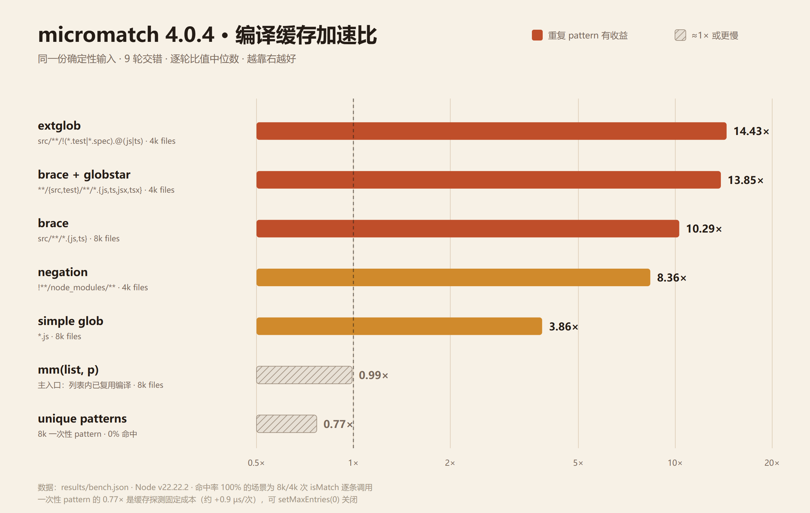
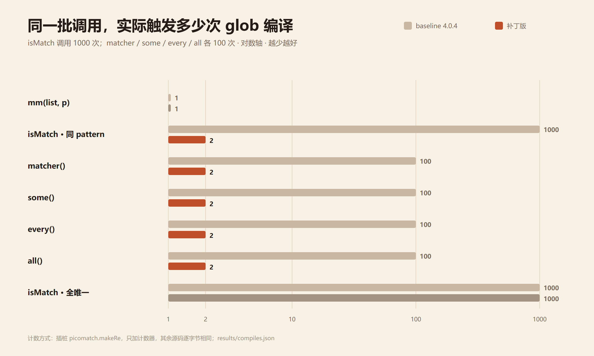
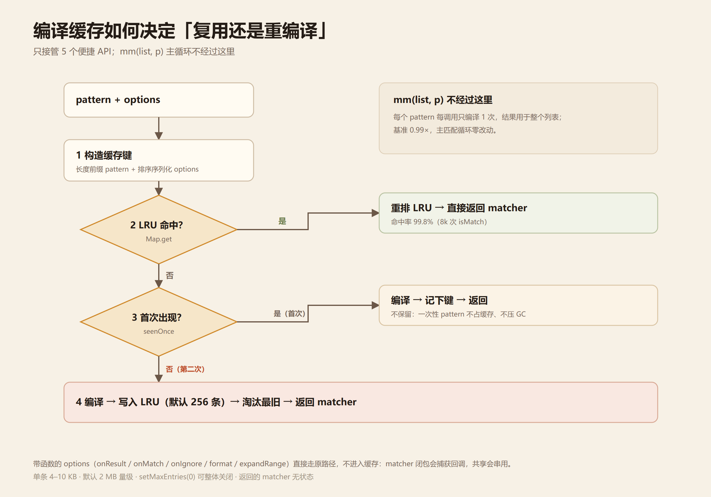

# micromatch 4.0.4 通配符匹配：编译结果复用审计与最小补丁

> 目标：只消除**确实存在且可复现**的重复计算，不改匹配语义。
> 结论先行：`micromatch()` 主入口本来就把编译结果摊薄到了整个列表，**不需要改**；
> 真正反复重编译的是 `isMatch / some / every / all / matcher` 这 5 个便捷 API。
> 补丁只挂在这 5 个调用点，主匹配循环一行未动。



- 被测版本：`micromatch@4.0.4` + `picomatch@2.3.0` + `braces@3.0.2`（与 `fuzzyjs-perf/node_modules` 中一致）
- 运行环境：Windows 10 / Node v22.22.2
- 基线副本：`vendor/micromatch-4.0.4`（原样复制，未改动）
- 补丁副本：`vendor/micromatch-4.0.4-cached`

---

## 1. 现状审计：哪里复用了，哪里没有

读 `index.js` 后逐个 API 核对编译时机，再用 `bench/count-compiles.js` 挂 `picomatch.makeRe` 计数验证（1000 个文件、`src/**/*.{js,ts}`）：

| API | 编译时机 | baseline 实际编译次数 | 结论 |
|---|---|---:|---|
| `mm(list, patterns)` | 每个 pattern 每次调用编译 1 次，结果用于整个 list | 1 | **已复用**，无需优化 |
| `mm.isMatch(file, p)` | 每次调用重新编译 | 1000 | 重复计算 |
| `mm.matcher(p)` | 每次调用重新编译；返回的函数内部复用 | 100 | 重复计算 |
| `mm.some/every/all` | 每个 pattern 每次调用重新编译 | 100 | 重复计算 |
| `mm.capture/makeRe` | 每次调用重新编译 | — | 有状态风险（`/g` 的 `lastIndex`），不改 |
| `mm.not/contains` | 走 `micromatch()` / `isMatch()` | — | 间接受益，无需单改 |

补丁后的编译次数（同一脚本）：

```
mm(list, pattern)           1  ->  1
isMatch x 1000 (same p)  1000  ->  2   (首次 + 准入各一次，之后 998 次命中)
matcher() x 100         100  ->  2
some/every/all x 100    100  ->  2
isMatch, unique patterns 1000 -> 1000  (全部未命中，符合预期)
```



**为什么只改这 5 个**：`mm(list, p)` 的 8000 文件基准是 1.64 ms，其中编译只占约 0.008 ms（0.5%）。
为这 0.5% 去动主循环，语义风险与收益完全不成比例——基准里它保持 `0.99×`，即没有变化。

---

## 2. 补丁设计

新增 `lib/compile-cache.js`（约 160 行），`index.js` 只改 5 行调用点：

```js
micromatch.matcher = (pattern, options) => compileCache.get(pattern, options);
micromatch.isMatch = (str, patterns, options) => compileCache.get(patterns, options)(str);
// some / every / all 同样把 picomatch(...) 换成 compileCache.get(...)
```



### 2.1 缓存键

`模式 = 's' + pattern.length + ':' + pattern | 'j' + JSON(pattern)`
`键 = 模式 + '|' + stableStringify(options)`

- 长度前缀消除「pattern 内含分隔符」时的歧义；
- options 按 key 排序后序列化，`{dot:true,nocase:true}` 与 `{nocase:true,dot:true}` 命中同一条；
- `undefined` 与 `{}` 视为两条（语义等价，但避免额外归一化开销）。

### 2.2 只缓存「数据型 options」

只要 options 里出现函数（`onResult / onMatch / onIgnore / format / expandRange`）或非普通对象，
就完全走原路径。原因：picomatch 的 matcher 闭包会捕获这些回调，缓存会把第一次调用者的回调
泄漏给后续调用者。这条规则由 `test/differential.test.js` 的回调测试单独验证。

### 2.3 二次准入（避免一次性 pattern 拖垮 GC）

首次见到的 pattern **只编译、不保留**；第二次见到才写入缓存。
这是实测出来的必要设计，不是拍脑袋：

| 方案 | S2（8000 个唯一 pattern） |
|---|---:|
| 不做准入，首次即入缓存 | **0.54×**（慢近一倍） |
| 二次准入 | **0.77×** |

原因：一次性 matcher（regex + token 数组，单条约 4–10 KB）被保留后会在新生代活过几轮
scavenge、晋升老生代，GC 成本超过缓存收益。二次准入让它们和 baseline 一样即用即弃。

### 2.4 容量与开关

- LRU 上限 **256 条**（Map 插入序即 LRU 序，命中时 delete+set 重排）；
- `seenOnce` 上限 1024（4×），只存字符串键，不存 matcher；
- `micromatch.matcherCache.setMaxEntries(0)` 可**完全关闭**缓存（连键都不算），
  供「pattern 全是一次性」的负载退回 baseline 性能；
- 公开 `matcherCache.{clear, size, stats, setMaxEntries}`，`stats` 含 hits/misses/evictions/rejected。

### 2.5 内存

| pattern 类型 | 256 条合计 | 每条约 |
|---|---:|---:|
| `file-N.js` | 1.06 MB | 4.2 KB |
| `src/pkg-N/**/*.{js,ts}` | 2.00 MB | 8.0 KB |
| `src/pkg-N/**/!(*.test).@(js,ts)` | 2.64 MB | 10.6 KB |

持续命中同一 pattern 20 万次：堆峰值 **53.9 MB → 18.7 MB**（不再为每次调用生产一次性 matcher）。
全唯一 pattern：峰值 9.9 MB → 8.7 MB，基本持平。

---

## 3. 语义验证：差分测试

`npm test` → **24 个测试全部通过**，其中：

- `isMatch` 矩阵：41 个 pattern × 38 个输入 × 29 组 options ≈ **4.5 万条组合**，
  每条都跑「冷（首次）/ 准入 / 热（真正命中）」三遍，与基线逐字段比对；
- 覆盖 dotfile（`*` vs `{dot:true}` vs `.*`）、否定模式（`!*.js`、`!(*.test).js`、
  `!**/node_modules/**`）、路径分隔符（`windows/posix`、`\\`、混合斜杠）、
  转义（`\\*`、`\\{a,b\\}`、`\\[bar\\]`、`\\!foo`）、异常输入（空串、`[`、`{a,b`、
  非字符串、空数组、`null`、`maxLength`）；
- 回调语义：`onResult` 的调用次数/顺序/参数、`onMatch`/`onIgnore`、两个独立回调集互不串扰；
- 错误语义：`TypeError` / `SyntaxError` 的 name + message 完全一致，且抛错模式不会进缓存；
- 未改动 API 的回归：`not / contains / matchKeys / capture（含 flags:'g' 连调）/ makeRe / parse / braces / braceExpand / scan`；
- `matcher(p)(input, true)` 返回对象的 `glob/state/regex/posix/input/output/match/isMatch` 全字段比对。

关键不变量：

1. 函数型 options 永远不缓存 → 每次调用都是新闭包，回调不会错位；
2. 抛错的 pattern 先编译后入表 → 不会污染缓存；
3. 相同 pattern + 不同 options 是不同键（`dot/nocase/basename/ignore/contains/capture/flags/windows` 逐一验证）；
4. `mm(list, p)` 代码路径未改，输出与基线逐字节一致。

---

## 4. 性能基准（三类场景）

方法（沿用本项目性能基准纪律）：

- **每个单元独立子进程**，避免前一个场景的堆影响后一个；
- 每轮内 baseline / 命中 / 未命中 **交错执行**，轮换顺序；每轮取 best-of-3（S1a 取 best-of-21）；
- 表里绝对值取 9 轮最小值，**加速比取逐轮比值的中位数**（绝对值会随机器负载漂移，比值稳定）；
- 未命中 = 每次调用前清空缓存，强制重新编译（含 clear 的微小开销）；
- 同一份确定性语料，baseline 与补丁逐字节相同输入。

| 场景 | 操作数 | baseline 最优 | 命中缓存 | 未命中缓存 | 命中加速比 | 逐轮比值区间 | 命中率 |
|---|---:|---:|---:|---:|---:|---|---:|
| S1 同 pattern × 8k · `mm(list,p)` | 8000 | 1.64 ms | 1.66 ms | 1.77 ms | **0.99×** | 0.96–1.04 | — |
| S1 同 pattern × 8k · `isMatch`（brace） | 8000 | 33.51 ms | 3.58 ms | 37.27 ms | **10.29×** | 8.64–10.80 | 100% |
| S1 同 pattern × 8k · `isMatch`（简单 `*.js`） | 8000 | 6.82 ms | 1.67 ms | 9.41 ms | **3.86×** | 3.50–4.40 | 100% |
| S2 每次不同 pattern · 8k 唯一 × 1 目标 | 8000 | 26.58 ms | 34.23 ms | 34.23 ms | **0.77×** | 0.55–0.83 | 0% |
| S3a 复杂 extglob · `isMatch` | 4000 | 26.42 ms | 1.95 ms | 26.67 ms | **14.43×** | 13.23–16.69 | 100% |
| S3b 复杂 brace+globstar · `isMatch` | 4000 | 24.19 ms | 2.02 ms | 30.26 ms | **13.85×** | 10.88–16.65 | 100% |
| S3c 否定模式 `!**/node_modules/**` | 4000 | 13.04 ms | 1.66 ms | 13.70 ms | **8.36×** | 5.16–10.06 | 100% |

> 注：加速比是逐轮比值的中位数，表里的毫秒数取各轮最小值，两者相除不会完全相等。

读法：

- **S1 的 `mm(list,p)` 是 0.99×**，证明主入口没有被误伤，也说明它本来就没有冗余；
- **单个 pattern 重复匹配**（最常见的 `files.filter(f => mm.isMatch(f, p))`）是 10× 级别的收益；
- **复杂模式收益更大**（extglob 14.4×、brace+globstar 13.9×），因为编译成本更高；
- **全唯一 pattern 是 0.77×**，即缓存探测的固定成本（键构造 + 两次哈希查找 + 准入登记），
  约 +0.9 µs/次；这类负载可 `setMaxEntries(0)` 关掉，回到 baseline。

未命中列（强制每次编译）是 0.69–0.91×，同样是探测成本；S2 的 0.77× 是最真实的「永不命中」样本，
因为它不包含 `clear()` 的人为开销。

---

## 5. 复现

```bash
npm install              # picomatch 2.3.0 / braces 3.0.2（ZIP 内已附带 node_modules）
npm test                 # 24 个差分/单元测试
npm run bench            # 三类场景，输出 results/bench.{json,md}
npm run bench:memory     # 堆占用，需 --expose-gc（脚本内部已带）
npm run bench:compiles   # 编译次数计数（证据链）
npm run bench:all        # 全部
npm run assets           # 重新生成 README 图（需 playwright + 系统 Edge）
```

应用补丁到真实的依赖目录：

```bash
cd node_modules/micromatch
patch -p1 < /path/to/patch/micromatch-4.0.4-compile-cache.patch
```

补丁只新增 `lib/compile-cache.js` 并修改 `index.js` 的 5 个调用点，可用 `patch -R` 回滚。

---

## 6. 文件清单

```
micromatch-cache-lab/
├─ README.md                     # 本报告
├─ LICENSE                       # MIT（micromatch 原许可，见 vendor/*/LICENSE）
├─ package.json
├─ assets/                       # README 图（PNG + SVG 源）
│  ├─ speedup-by-scenario.*
│  ├─ compiles-per-run.*
│  └─ cache-decision-flow.*
├─ scripts/
│  └─ make-assets.cjs            # 从 results/*.json 生成图表
├─ vendor/
│  ├─ micromatch-4.0.4/          # 基线（原样复制）
│  └─ micromatch-4.0.4-cached/   # 补丁版
│     ├─ index.js                # 5 个调用点改为 compileCache.get
│     └─ lib/compile-cache.js    # 新增：键 / 准入 / LRU / 统计
├─ patch/
│  └─ micromatch-4.0.4-compile-cache.patch
├─ test/
│  ├─ differential.test.js       # 4.5 万组合差分 + 回调/错误/未改 API
│  └─ cache.test.js              # 命中、准入、LRU、淘汰、开关
├─ bench/
│  ├─ count-compiles.js          # 编译次数证据
│  ├─ scenarios.js               # 确定性语料与三类场景
│  ├─ runner.js                  # 单场景子进程，轮内交错
│  ├─ run.js                     # 总控 + 比值中位数
│  ├─ memory.js / memory-run.js  # 堆占用
│  └─ probe.js                   # 最初的探索性探针
└─ results/
   ├─ bench.json / bench.md
   ├─ compiles.json
   └─ memory.json / memory.md
```

---

## 7. 边界与不做的事

1. **不改 picomatch / braces**：编译发生在 `picomatch()` 内部，补丁只决定「要不要再编译一次」。
2. **不改 `mm(list,p)`**：它已经按 pattern 复用，改动只会增加风险。
3. **不缓存 `makeRe` / `capture`**：返回的 RegExp 可能带 `/g`，共享实例会让 `lastIndex` 串状态。
4. **options 必须是数据**：带函数时自动绕过缓存；调用方不要在首次使用后原地改写 options
   （键会随值变化重新编译，但同一对象上的回调注入不会被缓存感知——已通过绕过规则规避）。
5. **未运行上游完整测试套件**：`micromatch` 的 npm 包只发布 `index.js`，仓库测试不在本地副本里；
   这里以 4.5 万条差分矩阵 + 24 个测试替代，覆盖了公开 API 与边角输入。
6. **绝对值不可跨机引用**：报告里的比值可复现，毫秒数随机器/负载漂移（同一台机两次跑也可能差 30%）。
